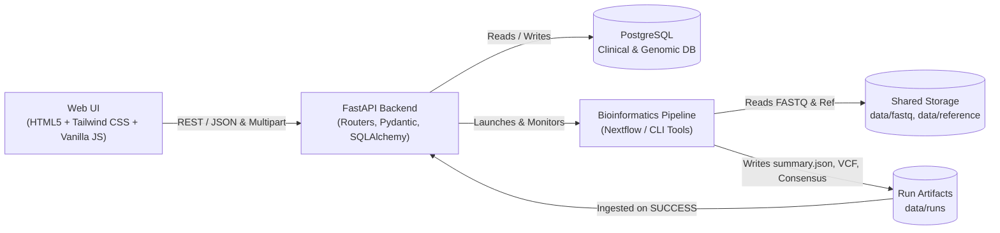

# BactGen

Clinical genomics web platform for bacterial Whole-Genome Sequencing (WGS) analysis, antimicrobial resistance profiling, and outbreak surveillance.

## Bioinformatics Pipeline

BactGen processes raw Illumina sequencing reads (`.fastq.gz`) through an automated five-stage whole-genome sequencing (WGS) workflow:

1. **`QC_TRIM` (`fastp`)**  
   Performs adapter trimming and base-quality filtering on raw reads while extracting core sequencing quality metrics, including raw and clean read counts and the Q30 base rate.

2. **`MAP_AND_CALL` (`minimap2` + `samtools` + `bcftools`)**  
   Aligns cleaned reads against the selected reference genome, computes mean sequencing depth and horizontal genome coverage, and executes haploid variant calling (`--ploidy 1`). Variants are filtered (`QUAL >= 30`, `DP >= 10`) to produce a high-confidence VCF file and a consensus sequence.

3. **`ASSEMBLE` (`MEGAHIT`)**  
   Performs *de novo* genome assembly from the cleaned reads, retaining contigs of at least `500 bp` to provide the sequence contiguity required for downstream typing and gene screening.

4. **`TYPING_AND_AMR` (`mlst` + `ABRicate`)**  
   Screens the assembled contigs to determine the isolate's Multi-Locus Sequence Type (ST) and allelic profile, and identifies antimicrobial resistance (AMR) genes using the NCBI database.

5. **`BUILD_SUMMARY` (`Python`)**  
   Consolidates QC metrics, alignment coverage, variant counts, MLST results, and AMR determinants into a structured `summary.json` report ready for ingestion into PostgreSQL via the FastAPI backend.

## Getting Started

### Prerequisites

* [Docker](https://docs.docker.com/get-docker/) and [Docker Compose](https://docs.docker.com/compose/)
* Git

### Installation & Startup

1. **Clone the repository and enter the project directory:**
   ```bash
   git clone <your-repository-url>
   cd BactGen
   ```

2. **Build and start the services (first run or after modifying `Dockerfile` / dependencies):**
   ```bash
   docker compose up -d --build
   ```

3. **Daily startup (once the Docker image is already built):**
   ```bash
   docker compose up -d
   ```

   Once running, open **`[http://127.0.0.1:8000/](http://127.0.0.1:8000/)`** in your browser.

> **Data Persistence:** To stop the platform without losing registered samples, sequencing runs, or analysis results stored in PostgreSQL, run `docker compose stop`. Avoid using `docker compose down -v`, as the `-v` flag removes persistent database volumes.

### Bundled Reference Genomes

BactGen includes three ready-to-use bacterial reference genomes in `data/reference/`:
* `S_aureus_NCTC8325.fasta` (*Staphylococcus aureus*)
* `E_coli_MG1655.fasta` (*Escherichia coli* K-12 MG1655)
* `K_pneumoniae_HS11286.fasta` (*Klebsiella pneumoniae* HS11286)

Additional `.fasta`, `.fa`, or `.fna` references can be placed directly in `data/reference/` or uploaded through the web interface.

---

## Usage

### Web Interface

1. **Browse Samples & Execution History**  
   The **Database Samples** table lists all registered clinical isolates. Click **Runs & Analyses** on any row to expand its linked sequencing runs (`R1`/`R2` files and MD5 checksums) and monitor pipeline executions (`QUEUED`, `RUNNING`, `SUCCESS`, or `FAILED`) in real time.

2. **Register a Sample & Attach FASTQ Reads**  
   Click **+ Add a Sample & Sequencing Run** to enter clinical metadata (`Sample ID`, `Organism`, `Collection Date`, `Hospital Ward`, and `Sample Source`). In the adjacent panel, attach single-end or paired-end `.fastq.gz` files either via drag-and-drop upload or by selecting files already present in `data/fastq/`.

3. **Run the WGS Pipeline & Inspect Results**  
   Select an active sample, choose one of its sequencing runs and a reference FASTA genome, and click **Launch Analysis**. Once the job finishes (`SUCCESS`), click **View Results** to inspect sequencing QC metrics (mean depth, genome coverage, Q30 rate), variant counts, MLST Sequence Type and alleles, and detected antimicrobial resistance (AMR) genes.

4. **Outbreak & Cluster Surveillance**  
   In the **Outbreak Surveillance** panel, adjust the **Max SNPs** threshold (default: `20` SNPs) and click **Update Clusters & SNPs** to group genetically related isolates into transmission clusters and review pairwise SNP distances.

### REST API

Interactive API documentation (Swagger UI) is available at **`[http://127.0.0.1:8000/docs](http://127.0.0.1:8000/docs)`**. Core endpoints include:

| Method | Endpoint | Description |
| :--- | :--- | :--- |
| `GET` / `POST` | `/samples` | List all samples or register a new clinical isolate |
| `GET` | `/samples/{sample_id}/sequencing-runs` | Retrieve sequencing runs linked to a sample |
| `POST` | `/samples/{sample_id}/sequencing-runs/upload` | Upload `R1`/`R2` FASTQ files and create a sequencing run |
| `POST` | `/analyses/upload-reference` | Upload a new reference genome (`.fasta`, `.fa`, `.fna`) |
| `GET` / `POST` | `/analyses` | List all pipeline runs or queue a new WGS analysis |
| `GET` | `/analyses/{analysis_id}/results` | Retrieve QC, MLST, variant, and AMR results for a completed run |
| `GET` | `/outbreaks/distances` | Query pairwise SNP distances below a given `max_snps` threshold |
| `GET` | `/clusters` | Detect putative outbreak clusters based on SNP distance thresholds |

---

## System Architecture

BactGen follows a four-tier containerized architecture that decouples the clinical web interface, API orchestration, bioinformatics execution, and relational persistence:



### Architectural Layers

1. **Presentation Layer (`app/static/`)**  
   A lightweight single-page dashboard built with **Tailwind CSS** and modular **Vanilla JavaScript** (`index.html`, `app.js`). It communicates asynchronously with the REST API to manage sample registration, FASTQ/FASTA file uploads, live status polling (`QUEUED` -> `RUNNING` -> `SUCCESS`), genomic result inspection, and interactive SNP threshold filtering for outbreak clusters.

2. **Application & Orchestration Layer (`app/`)**  
   Powered by **FastAPI** and **Pydantic** (`app/main.py`, `app/routers/`, `app/schemas.py`). It validates clinical and sequencing metadata, computes MD5 checksums on uploaded reads, dispatches pipeline executions asynchronously, parses the resulting `summary.json` into database records, and computes connected-component outbreak clusters from pairwise SNP distances.

3. **Bioinformatics Execution Layer (`Nextflow` & CLI Suite)**  
   Each analysis runs in an isolated working directory under `data/runs/`, executing `fastp`, `minimap2`, `samtools`, `bcftools`, `MEGAHIT`, `mlst`, and `ABRicate` against reference genomes stored in `data/reference/`.

4. **Persistence Layer (`PostgreSQL` + Docker Volumes)**  
   **PostgreSQL** stores relational entities (`samples`, `sequencing_runs`, `analysis_runs`, `genomic_results`, and `pairwise_distances`) in a persistent Docker volume, while raw reads, reference FASTA files, and pipeline outputs reside on mounted host directories (`data/`).
